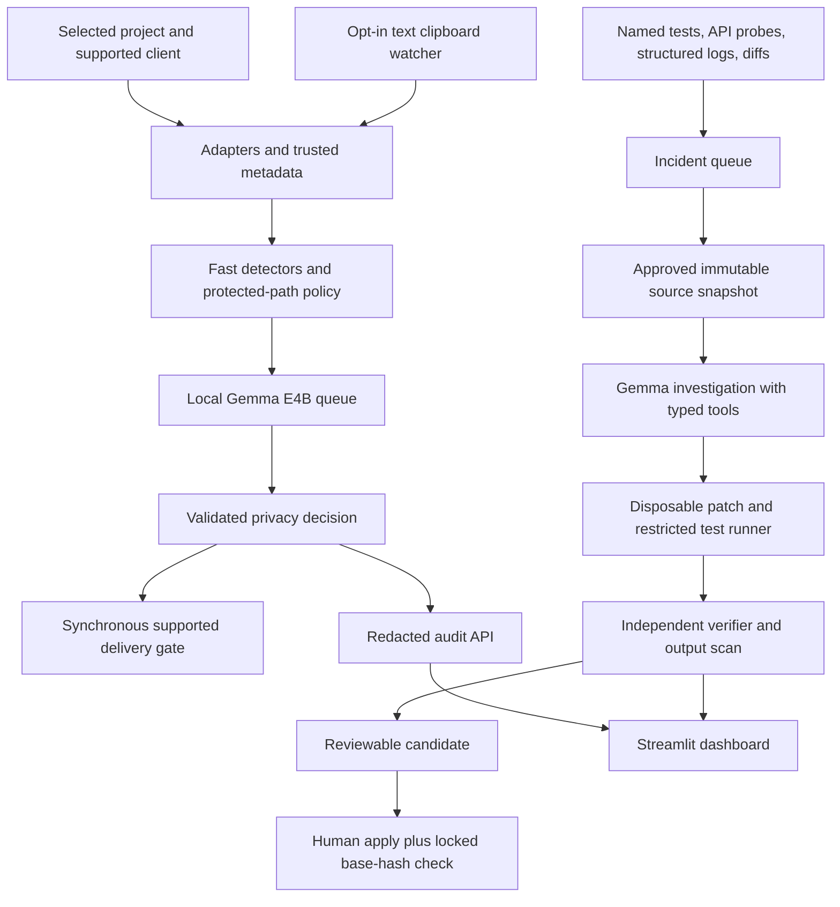

# Architecture and trust boundaries

The modules below are implemented in the integrated codebase. See [current status](PROFESSIONAL_STATUS.md) for measured scope and remaining integration gates. The primary browser workspace is served by the same FastAPI process; no separate frontend server is needed.



## Boundaries

1. **Client adapter:** receives only the event types the installed client exposes. Client version and paths tested determine coverage. Hooks do not automatically expose every attachment or automatic context load.
2. **Clipboard service:** consented text capture on a supported host. Clipboard observation is advisory; integrated delivery requires a separate gate. No images, screenshots, recordings or keyboard events.
3. **Trusted supervisor:** owns policy, scope validation, token handling, queues, audit storage and release. Repository code cannot edit these through model tools.
4. **Model:** proposes classifications, spans and actions; receives no policy-edit or original-source apply authority. Treat its output as untrusted until validated.
5. **Repair sandbox:** approved source only, dummy data, no production credentials or host Docker socket. Resource limits and fixed test commands.
6. **Dashboard:** displays redacted server decisions and makes authenticated requests. No model inference, secret decisions or file writes in UI code.

## Model queue

One E4B runtime initially. Foreground guarded requests take priority over clipboard contextual analysis and idle repair; scan stages have finite timeouts. A request waiting on the model stays held. A busy or crashed model never silently converts a pending privacy check into ALLOW.

Separate cache keys include immutable content digest, task, policy revision, destination and model digest. Never log unhashed copied text. For sensitive clipboard deduplication, prefer a session-keyed digest rather than a public hash of guessable values. Cache only short-lived decisions; revalidate before send.

## Authority and data

- Capture source, canonical paths and destinations are supplied by trusted adapters, not Gemma or UI assertions.
- Raw guard input lives in bounded memory; audit APIs expose only redacted views. Disable raw request-body and model-body logging.
- The approved delivery bytes are bound to request ID, content version, destination, policy version and expiry. A previous result cannot authorise different content.
- Tool results are checked before subsequent model delivery. Log ingestion by itself is not enforcement.
- Named API probes target configured local demo services; no arbitrary model-supplied URLs.
- Reports, diffs and export files receive final privacy scans.

## Repair tool interface

`list_allowed_files`, `read_allowed_file`, `get_selected_diff`, `search_sanitized_logs`, `get_service_status`, `run_named_test`, `propose_patch`, `apply_patch_in_sandbox`, `verify_candidate`.

Arguments have strict schemas, size limits and path scope. Resolve symlinks and prevent traversal. Results are bounded and sanitised. Tool/test definitions and expected outcomes remain outside model-writable paths. No unrestricted host shell.

First tools can be implemented as an in-process registry. An MCP adapter is optional and does not replace filesystem and tool restrictions.

## Modules and interfaces

Mac 1 owns API startup, shared Pydantic schemas, guard, model queue, clipboard service and storage. Mac 2 exports a repair router and worker interface and owns client adapters and trusted verification. Register Mac 2's router in Mac 1's app; do not create competing backend servers or SQLite writers with different schemas.

Target layout:

```text
devguard/
  api/       schemas/    guard/     models/     clipboard/   storage/
  agent/     monitor/    repair/    ui/
integrations/
demo/backend/
demo/fixtures/
trusted_tests/
tests/backend/
tests/ui/
evals/cases/
evals/results/
docs/
```

## Machine topology

Prefer one Mac for the final presentation if measurement permits. During development, each machine works against mocks or its own local services. A two-Mac live setup is optional: Mac 1 hosts the guard/model and Mac 2 runs the repair sandbox. Authenticate and tunnel traffic; enrol both machines in the trusted processing boundary and label network processing explicitly. Never bind Ollama openly on event Wi-Fi. Windows UI can use labelled fixtures or an authenticated backend connection; it does not receive raw clipboard originals.
